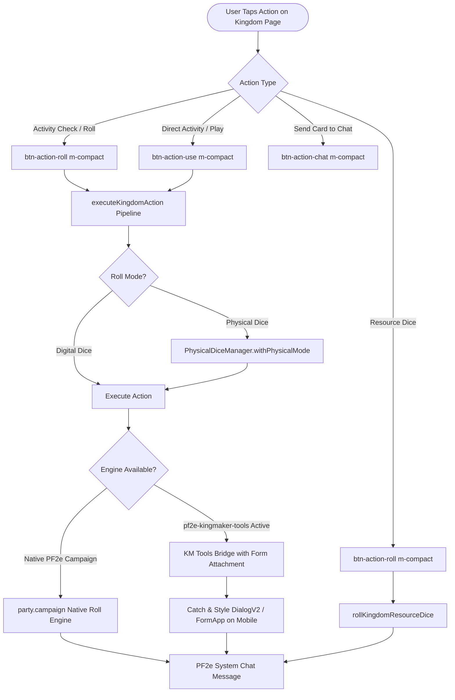

# Issue: Kingdom Page Overhaul — Robust Dice Rolling & Activity Execution, Native PF2e Fallback, and Claude CSS Style Guide Alignment

**Type**: Bug Fix, Architecture Refactor & UX Alignment  
**Status**: Proposed / Under Review  
**Milestone**: Kingdom Sheet & UI System Harmonization  

---

## 1. Summary & Problem Statement

The **Kingdom Page** (`templates/kingdom/`, `scripts/kingdom/kingdom-handlers.js`, and `styles/kingdom.css`) provides mobile access to kingdom management for Kingmaker campaigns. However, testing and gameplay experience reveal critical flaws in dice rolling, activity execution, and styling consistency:

1. **Failure to Roll Dice & Execute the "Perform" Option**:
   - **Tightly Coupled to `pf2e-kingmaker-tools`**: The current execution pipeline (`dispatchKingdomSheetAction`) hard-fails if `pf2e-kingmaker-tools` is not installed or fails to initialize in the background (`ui.notifications.warn("pf2e-kingmaker-tools Kingdom Sheet is not available")`). It lacks any fallback to Pathfinder 2e's native Kingmaker campaign engine (`partyActor.system.campaign` / `partyActor.campaign.skills`).
   - **Detached DOM Element Event Invocation**: To trigger actions on the hidden desktop `KingdomSheet` instance, `dispatchKingdomSheetAction` creates an orphan button element (`document.createElement("button")`) that is not connected to the DOM or to `kmApp.form`. When `kmApp._onClickAction` attempts to resolve relative form state, active leader values, or active settlement IDs, it either fails silently or throws errors.
   - **Modal Dialog Lifecycle & Mobile Viewport Clipping**: When an activity check opens a dialog (e.g. `KingdomCheckDialog`), the dialog is rendered as a desktop window that overflows phone viewports (390px). In `scripts/pf2e-mobile.js`, the hook interceptor listens exclusively to `renderApplicationV2`; if `KingdomCheckDialog` inherits from ApplicationV1 (`FormApplication` or `Dialog`), the styling hook never triggers, leaving the user with an unresponsive or invisible prompt.
   - **Missing Resource Dice Roll Button**: In Upkeep Step 3 ("Collect Resources: Roll Xd6"), the resource dice pool is rendered purely as static text (`<span class="km-rp-val">{{km.rdNowDisplay}}</span>`). Players have no interactive button to actually roll their Kingdom Resource Dice into chat.
   - **Immediate Synchronous Re-render Collision**: `dispatchKingdomSheetAction` calls `sheet.render({ parts: ["header", "sheet"] })` immediately upon dispatching an action. This synchronous re-render races with asynchronous dialog creation in Foundry, clobbering active focus or closing the dialog before the user can interact with it.

2. **Removal of Gaining Experience Section from Mobile App**:
   - The Turn Flow currently displays a crowded "Turn XP & End Turn" card with ad-hoc XP award buttons (`+1 Hex XP`, `+2 Hexes XP`, `Farm/Worksite (+10 XP)`, `Bridge/Road (+5 XP)`, `Structure XP`, `Unused Solution XP`, `Convert RP to XP`).
   - Manual XP attribution and bookkeeping is a desktop GM/administrative task that clutters the mobile turn interface.
   - The section about gaining experience will be removed entirely, replacing the card with a streamlined, responsive "End Turn" card containing only Level Up and End Kingdom Turn actions.

3. **Divergence from the Claude CSS Workflow & Style Guide (`docs/style-guide.html`)**:
   - In PR #22 (commit `c75c2d1`), the character, party, actions, inventory, spells, and header sheets were refactored into a cohesive design system using:
     - Reusable layout utilities (`m-flex-row`, `m-flex-col`, `m-align-*`, `m-gap-*`, `m-truncate`, `m-wrap`).
     - Standard type scale (`m-text-xs` 11px, `m-text-sm` 12px, `m-text-md` 13px, `m-text-base` 14px, `m-text-xl` 15px, `m-bold`, `m-semibold`, `m-medium`).
     - Six neutral text greys (`m-color-strong`, `m-color-normal`, `m-color-soft`, `m-color-muted`, `m-color-dim`, `m-color-faint`) and semantic role colors (`m-color-accent`, `m-color-success`, `m-color-warning`, `m-color-danger`).
     - Shared control components (`m-compact` for 38px control heights, `m-card`, `m-badge`, `m-badge-neutral`).
   - In contrast, `templates/kingdom/` and `styles/kingdom.css` contain **660+ lines of custom, ad-hoc classes**:
     - `.km-perform-btn` uses hardcoded colors (`#b7f7c6`, `rgba(65, 145, 85, 0.25)`), arbitrary font sizes (`0.8rem`), and non-standard padding (`5px 11px`), completely bypassing `--m-*` palette tokens.
     - Buttons display text labels (`Perform`) rather than following the sleek, icon-based quick buttons on card headers used on the normal character sheet.
     - Custom classes like `.km-card`, `.km-btn-sm`, `.km-btn-secondary`, `.km-skill-btn`, and `.km-subtab-btn` duplicate styling that is already standardized across the core stylesheet.

---

## 2. Technical Design & Architecture



---

### 2.1. Unified Character Sheet Button Pattern for Kingdom Activities

To align with the character sheet action card pattern (`templates/parts/actions/action-card.hbs`), kingdom activity cards in `templates/kingdom/kingdom-turn.hbs` will be refactored to use standard components and utility classes:

```handlebars
<div class="m-action-card m-card km-activity-card {{#if this.isExpanded}}expanded{{/if}}" data-activity-id="{{this.id}}">
  <div class="m-card-line m-flex-row m-align-center" data-action="toggleKingdomActivity" data-activity-id="{{this.id}}">
    <div class="m-card-main m-flex-col m-min-w-0">
      <div class="m-card-title m-flex-row m-align-center m-gap-4">
        <span class="activity-name m-min-w-0 m-truncate m-bold m-text-base m-color-strong">
          {{this.displayName}}
        </span>
      </div>
      {{#if this.skills.length}}
      <div class="activity-skills m-flex-row m-wrap m-gap-4">
        {{#each this.skills}}
        <span class="m-badge-neutral m-text-xs m-color-soft">{{this.label}}</span>
        {{/each}}
      </div>
      {{/if}}
    </div>

    <!-- Quick Buttons Group: Identical to Character Sheet Action Cards -->
    <div class="action-btn-group m-flex-row m-align-center m-gap-6 m-shrink-0">
      {{#if this.hasCheck}}
      <button type="button" 
              class="btn-action-roll m-compact m-inline-flex m-align-center m-justify-center m-text-base m-semibold m-color-strong"
              data-action="performKingdomActivity" 
              data-activity-id="{{this.id}}" 
              data-activity-name="{{this.displayName}}"
              data-roll-type="check"
              title="Roll Check ({{this.displayName}})"
              {{#if this.disabled}}disabled{{/if}}>
        <i class="fa-solid fa-dice-d20"></i>
      </button>
      {{else}}
      <button type="button" 
              class="btn-action-use m-compact m-inline-flex m-align-center m-justify-center m-text-base m-semibold m-color-strong"
              data-action="performKingdomActivity" 
              data-activity-id="{{this.id}}" 
              data-activity-name="{{this.displayName}}"
              data-roll-type="action"
              title="Perform {{this.displayName}}"
              {{#if this.disabled}}disabled{{/if}}>
        <i class="fa-solid fa-play"></i>
      </button>
      {{/if}}
      
      <button type="button" 
              class="btn-action-chat m-compact m-inline-flex m-align-center m-justify-center m-text-base m-color-strong"
              data-action="postKingdomActivityChat" 
              data-activity-id="{{this.id}}"
              title="Post to Chat">
        <i class="fa-solid fa-message"></i>
      </button>
    </div>
  </div>
  
  <!-- Activity Drawer Details -->
  <div class="m-card-drawer km-activity-details">
    {{!-- Description, Requirements, Degrees of Success --}}
  </div>
</div>
```

#### Key Advantages:
1. **Visual Harmony**: Kingdom activities look and feel indistinguishable from standard character feats, strikes, and actions.
2. **Standard 38px Touch Targets**: Replaces ad-hoc `padding: 5px 11px` with `m-compact` ensuring accessibility and effortless finger tapping.
3. **Clear Functional Distinction**:
   - `fa-dice-d20` (`btn-action-roll`): Clearly indicates a d20 skill check with DC.
   - `fa-play` (`btn-action-use`): Clearly indicates an administrative or structural action that takes effect without a roll.
   - `fa-message` (`btn-action-chat`): Allows posting the activity rules and degrees of success to chat without triggering the roll.

---

### 2.2. Robust Dual-Tier Execution Engine & Native PF2e Fallback

`scripts/kingdom/kingdom-handlers.js` must be refactored so that rolling dice and performing activities never relies on a brittle single point of failure:

#### Tier 1: Native PF2e Kingmaker Campaign Delegation
When `partyActor.campaign` (or `partyActor.system.campaign`) is present:
- **Skill Checks**:
  ```javascript
  const campaign = partyActor.campaign;
  if (campaign?.skills?.[skillSlug]) {
    return campaign.skills[skillSlug].roll(event);
  }
  ```
- **Activity Rolls**:
  PF2e Kingmaker compendia store official Kingdom activities as `Item` documents of type `campaignFeature`. Native PF2e provides `campaign.rollAction(event, activityId)` and `campaign.activities`. If native PF2e methods exist, invoke them directly.

#### Tier 2: `pf2e-kingmaker-tools` Delegation with Proper DOM Attachment
When `pf2e-kingmaker-tools` is active:
1. Ensure the synthesized button is appended directly to `kmApp.form || kmApp.element` before triggering `_onClickAction`, and removed immediately afterward.
2. Ensure the active leader and settlement dropdowns on the mobile sheet properly synchronize their values to the underlying `kmApp` form elements beforehand.
3. Suppress unconditional immediate re-rendering: only re-render the sheet when `kmApp` operations resolve and no modal dialog is actively awaiting user input.

#### Tier 3: Resource Dice Rolling (`rollKingdomResourceDice`)
Add a dedicated handler for rolling Kingdom Resource Dice during the Upkeep phase or Status view:
```javascript
export async function onRollKingdomResourceDice(sheet, event) {
  const partyActor = getPartyActor(sheet.actor);
  const flag = partyActor?.getFlag?.("pf2e-kingmaker-tools", "kingdom-sheet") || {};
  const campaign = partyActor?.system?.campaign;
  
  const count = (flag.level ?? campaign?.level ?? 1) + 4;
  const formula = `${count}d6 + ${flag.resourceDice?.bonus ?? 0}`;
  
  const rollAction = async () => {
    const roll = new Roll(formula);
    await roll.evaluate();
    await roll.toMessage({
      speaker: ChatMessage.getSpeaker({ actor: partyActor }),
      flavor: `<strong>Kingdom Resource Dice</strong> (Level ${flag.level ?? campaign?.level ?? 1})`
    });
  };

  await PhysicalDiceManager.withPhysicalMode({
    title: "Kingdom Resource Dice",
    actor: partyActor
  }, rollAction, sheet.rollMode === "physical");
}
```

---

### 2.3. Mobile Dialog Viewport Interception (V1 & V2)

In `scripts/pf2e-mobile.js`:
1. Expand the dialog hooks beyond `renderApplicationV2` to include `renderApplication` and `renderDialog`.
2. Inspect opened dialogs:
   ```javascript
   function styleKingdomDialog(app, element) {
     const isKmDialog = element.classList.contains("km-dialog-form") 
       || element.querySelector?.(".km-check-dialog")
       || app.constructor?.name === "KingdomCheckDialog";
     if (!isKmDialog) return;
     
     element.classList.add("pf2e-mobile-dialog", "compact-theme", "km-mobile-check-dialog");
     // Ensure max-width: 94vw, auto-height, and 38px minimum for all modal buttons
   }
   Hooks.on("renderApplicationV2", (app, element) => styleKingdomDialog(app, element));
   Hooks.on("renderApplication", (app, element) => styleKingdomDialog(app, element[0] || element));
   ```

---

### 2.4. Claude CSS Workflow & Style Guide Compliance

1. **Retire Ad-Hoc CSS in `styles/kingdom.css`**:
   - Deprecate `.km-perform-btn`, `.km-card`, and duplicate utility classes.
   - Refactor `styles/kingdom.css` to only retain specific domain layouts (such as settlement grid hex overlays or commodity counters), with all colors mapped to `--m-*` variables.
2. **Template Modernization**:
   - Refactor `templates/kingdom/kingdom-turn.hbs` and `templates/kingdom/kingdom-sheet-tab.hbs` to use:
     - `m-card` / `m-action-card` for activity cards.
     - `m-compact` for all interactive buttons and dropdowns.
     - `btn-action-roll`, `btn-action-use`, `btn-action-chat` for activity actions.
     - `m-badge` and `m-badge-neutral` for traits and metadata tags.
3. **Update Style Guide (`docs/style-guide.html`)**:
   - Add sample cards and button controls for Kingdom Activities and Kingdom Skills.
   - Ensure `node scripts/verify.mjs` executes cleanly with 0 errors.

---

## 3. Modular Code Structure & AGENTS.md Compliance

To adhere to the architectural file-size discipline in `AGENTS.md` (orchestrator < 700 lines, helpers < 500 lines), `scripts/kingdom/kingdom-handlers.js` (currently 1028 lines) must be modularized:

1. **`scripts/kingdom/kingdom-context.js`** (< 450 lines):
   - `prepareKingdomContext`, `applyKingdomFlagFallback`, `normalizeKingdomViewData`.
2. **`scripts/kingdom/kingdom-actions.js`** (< 350 lines):
   - `onPerformKingdomActivity`, `onRollKingdomSkillCheck`, `onRollKingdomResourceDice`, `dispatchKingdomSheetAction`, native PF2e roll fallbacks.
3. **`scripts/kingdom/kingdom-dialogs.js`** (< 300 lines):
   - `onOpenConsumptionBreakdown`, `onInspectKingdomSettlement`, `onResolveKingdomEvent`.
4. **`scripts/kingdom/kingdom-handlers.js`** (< 80 lines):
   - Clean re-export barrier preserving existing external module and sheet imports.

---

## 4. Acceptance Criteria & Verification

- [ ] Kingdom activity cards use standard character sheet styling (`m-action-card`, `m-compact`, `btn-action-roll`, `btn-action-use`, `btn-action-chat`).
- [ ] Section about gaining experience is removed entirely from the mobile app, leaving a clean and responsive End Turn card.
- [ ] Tapping the check button (`btn-action-roll`) on a Kingdom activity prompts or rolls the check with DC and degree of success.
- [ ] Tapping the perform button (`btn-action-use`) executes the activity without requiring a check.
- [ ] If `pf2e-kingmaker-tools` is active, actions dispatch cleanly through its background sheet without DOM detachment errors.
- [ ] If `pf2e-kingmaker-tools` is inactive or missing, rolls fall back smoothly to PF2e's native `partyActor.campaign` statistics.
- [ ] Tapping the Resource Dice button rolls the Kingdom's Resource Dice (`Xd6 + bonus`) directly to chat.
- [ ] Both Digital and Physical dice modes intercept Kingdom skill checks, activity rolls, and resource dice correctly.
- [ ] Dialogs (e.g. `KingdomCheckDialog`) render responsive, mobile-optimized layouts with touch-friendly controls on screens $\le 390\text{px}$.
- [ ] All custom styles in `styles/kingdom.css` and `templates/kingdom/` conform to `docs/style-guide.html` and use `--m-*` palette tokens.
- [ ] Static verifications pass (`node scripts/verify.mjs` exits with 0 errors).
- [ ] Strict compliance with the Foundry VTT AI Content Policy (zero AI media, zero runtime `eval`, human-maintainable modular structure).
