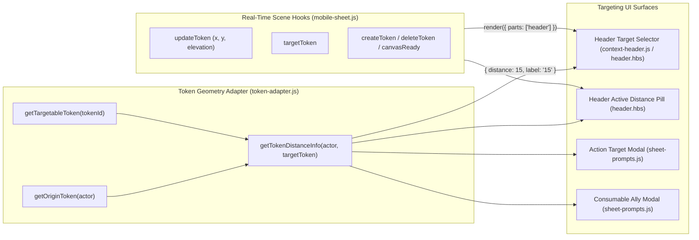

# Issue: Display Real-Time Target Distance Next to Targeted Enemy Names (`Name (distance)`)

**Type**: Feature Enhancement & Mobile Combat UX  
**Status**: Proposed / Ready for Implementation  
**Milestone**: Mobile Targeting & Spatial Awareness  

---

## 1. Summary & Problem Statement

When playing Pathfinder 2e on a mobile device (especially in headless canvas mode or around a shared TV table map), players select and switch targets using the mobile sheet's **Header Target Selector** (`🎯`) or the **Action Target Modal** (`Target for <Action>`). Currently, token options only display the token's name (`🎯 Goblin Warrior`).

This creates several combat UX challenges on mobile:
1. **Lack of Immediate Spatial & Reach Awareness**: Players cannot immediately tell from their phone whether a targeted enemy is adjacent (`5`), within reach weapon distance (`10`), within thrown/point-blank range (`20–30`), or out of spell range (`30–120`).
2. **Distinguishing Identical Monster Names**: When multiple enemies share similar or identical names on a scene, seeing `Goblin Warrior (5)` vs `Goblin Warrior (35)` immediately clarifies which enemy is engaged with the character in melee.
3. **Scroll & Selection Friction in Large Encounters**: Currently, target dropdowns list tokens in raw scene collection order rather than sorting closest enemies first.
4. **Compact Format Without Unit Clutter**: Omitting `ft` inside the parentheses—formatting strictly as `Name (15)` instead of `Name (15 ft)`—saves 3 characters of horizontal width in the compact mobile header dropdown while remaining completely intuitive.

---

## 2. Technical Design & Architecture

### 2.1. Distance Calculation Engine (`scripts/tokens/token-adapter.js`)

1. **Zero Custom Distance Math — Native PF2e & Foundry `BaseGrid` Delegation**:
   - Implemented [`measurePF2eTokenDistance(tokenA, tokenB, options)`](file:///d:/Dnd/coding/pf2e-mobile-compact/scripts/tokens/token-adapter.js#L131-L165), which delegates strictly to PF2e and Foundry VTT native APIs:
     - **Live Canvas Mode (`canvas.ready === true`)**: Invokes PF2e's native `TokenPF2e.prototype.distanceTo` (`CONFIG.Token.objectClass.prototype.distanceTo.call(selfObj, targetObj)`).
     - **Headless / Mobile Canvas Mode (`canvas.ready === false`)**: Invokes Foundry VTT's native [`foundry.grid.BaseGrid#measurePath`](https://foundryvtt.com/api/classes/foundry.grid.BaseGrid.html) (`grid.measurePath([pA, pB]).distance`) on `scene.grid` (which natively executes PF2e's `5-10-5` diagonal rule and 3D elevation measurement without needing an active WebGL canvas).
2. **Robust Origin Token Resolution (`getOriginToken(actor, sceneOverride)`)**:
   - Resolves the actor's active scene token across live placeables, `actor.getActiveTokens(false, false)` (catching unlinked tokens), and `scene.tokens.contents` (matching `actorId`, `actor.id`, or base actor ID).
3. **Centralized Distance Helper `getTokenDistanceInfo(actor, targetTokenOrId)`**:
   - Resolves `originToken = getOriginToken(actor, scene)` and `targetToken` on the active scene.
   - Returns `null` if the character or target has no token on the active scene.
   - Computes grid-aware distance via `measurePF2eTokenDistance(originToken, targetToken, { scene })` and formats the numeric distance cleanly without unit suffixes:
     - Returns `{ distance: number, label: string }` (e.g., `{ distance: 15, label: "15" }`).

---

### 2.2. UI Surfaces & Mobile UX

#### A. Header Target Dropdown & Active Distance Pill (`context-header.js` & `header.hbs`)
- **Dropdown Option Format (`Name (distance)`)**:
  - In [`prepareHeaderContext(actor, sheet, context)`](file:///d:/Dnd/coding/pf2e-mobile-compact/scripts/apps/sheet-helpers/context-header.js#L129-L157), compute `distInfo = getTokenDistanceInfo(actor, t.id)` for every targetable scene token.
  - Each item in `context.targets` includes:
    - `id`: Token ID
    - `name`: Raw token name (`"Goblin Warrior"`)
    - `distance`: Numeric distance (`15` or `null`)
    - `distanceLabel`: Numeric string (`"15"` or `null`)
    - `displayName`: `distInfo ? `${t.name} (${distInfo.label})` : t.name` (`"Goblin Warrior (15)"`)
    - `selected`: Boolean
  - In [`templates/parts/header.hbs`](file:///d:/Dnd/coding/pf2e-mobile-compact/templates/parts/header.hbs#L20-L27), `<option>` renders `🎯 {{this.displayName}}` (e.g. `🎯 Goblin Warrior (15)`).
- **Anti-Truncation Active Distance Badge**:
  - Expose `context.activeTarget` on `context` when a target is currently selected.
  - Render a compact badge (`({{activeTarget.distanceLabel}})`) alongside the header target selector when `activeTarget.distanceLabel` is present, and set `title="Target: {{activeTarget.displayName}}"` on the `<select>`.
  - This guarantees that even when a monster's name is long enough to ellipsis-truncate inside the closed `<select>` (`Skeletal Champion`), the `(15)` distance remains 100% readable in the sticky header.
- **Distance-First Sorting**:
  - Sort `context.targets` by `distance` ascending (closest enemies first, `null` distances last, with alphabetical tie-breaker).

#### B. Action Target Selection Modal (`scripts/apps/sheet-helpers/sheet-prompts.js`)
- In [`promptTargetSelection(sheet, actionLabel)`](file:///d:/Dnd/coding/pf2e-mobile-compact/scripts/apps/sheet-helpers/sheet-prompts.js#L26-L91):
  - Enrich each available token with `getTokenDistanceInfo(sheet.actor, t.id)`.
  - Sort tokens closest-first (`distance` ascending).
  - Format each `<option>` in `#action-target-select` as `${t.name} (${t.distanceLabel})` (e.g., `Goblin Warrior (15)`).

#### C. Consumable Ally Selection Modal (`scripts/apps/sheet-helpers/sheet-prompts.js`)
- In [`promptConsumableUsage(sheet, item)`](file:///d:/Dnd/coding/pf2e-mobile-compact/scripts/apps/sheet-helpers/sheet-prompts.js#L261-L333):
  - Enrich each ally/comrade candidate with `getTokenDistanceInfo(sheet.actor, c.id)`.
  - Sort comrades closest-first and format each `<option>` as `Comrade: ${c.name} (${c.distanceLabel})` (e.g., `Comrade: Kyra (5)`), allowing players to immediately verify whether an ally is within `5` reach to administer a potion or elixir.

---

### 2.3. Real-Time Token Movement Synchronization

- [`PF2eMobileSheet._registerSceneListeners()`](file:///d:/Dnd/coding/pf2e-mobile-compact/scripts/apps/mobile-sheet.js#L374-L403) already subscribes to `updateToken`, `createToken`, `deleteToken`, `targetToken`, and `canvasReady`, calling `this.render({ parts: ["header"] })`.
- Whenever the player's own token or any enemy token moves (`x`, `y`) or changes `elevation` on the scene, `updateToken` triggers a lightweight `header` part re-render, updating `Name (distance)` and the active distance badge in real time.

---

## 3. Step-by-Step Implementation Plan

1. **Token Geometry (`scripts/tokens/token-adapter.js`)**:
   - Update `getOriginToken(actor)` to ensure live placeables pass through `getTargetableToken(placeable.id)`.
   - Add and export `getTokenDistanceInfo(actor, targetTokenOrId)` returning `{ distance, label: String(distance) }`.
2. **Header Context & Template (`scripts/apps/sheet-helpers/context-header.js` & `templates/parts/header.hbs`)**:
   - Enrich `context.targets` with `distance`, `distanceLabel`, and `displayName` (`Name (15)`).
   - Sort `context.targets` by distance ascending and expose `context.activeTarget`.
   - Update `header.hbs` to display `🎯 {{this.displayName}}` and the compact `({{activeTarget.distanceLabel}})` indicator.
3. **Targeting Modals (`scripts/apps/sheet-helpers/sheet-prompts.js`)**:
   - Update `promptTargetSelection` and `promptConsumableUsage` to include `(${distanceLabel})` without `ft` and sort by distance ascending.
4. **Styling (`styles/pf2e-mobile.css`)**:
   - Style `.header-target-group` and `.header-target-distance-pill` to fit cleanly in the 38px header row on 360px–430px mobile viewports while preserving minimum 38px–48px touch targets.
5. **Verification & Changelog**:
   - Run `node scripts/verify.mjs` to validate syntax, `<select>` `data-change-action` rules, and touch targets.
   - Document in `CHANGELOG.md`.

---

## 4. Acceptance Criteria

- [ ] Header target selector `<option>` entries display `🎯 Name (distance)` with numeric distance only (e.g. `🎯 Goblin Warrior (15)`).
- [ ] When a target is active, its distance (`(15)`) remains visible in the sticky header even if the enemy's name is long enough to ellipsis-truncate inside the closed `<select>`.
- [ ] Action target selection modal (`promptTargetSelection`) and consumable ally modal (`promptConsumableUsage`) display `Name (15)` and sort closest tokens first.
- [ ] Moving either the player token or the target token on the canvas automatically updates the displayed distance in the header.
- [ ] Graceful fallback: if the character has no token on the active scene, token names render as `Name` without empty parentheses or errors.
- [ ] `node scripts/verify.mjs` passes with 0 errors.
